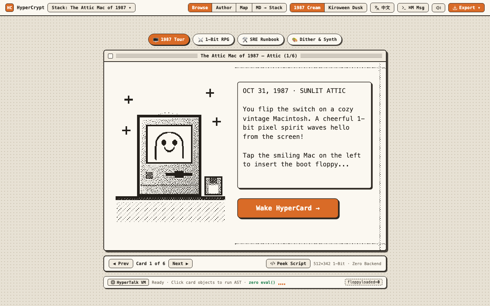
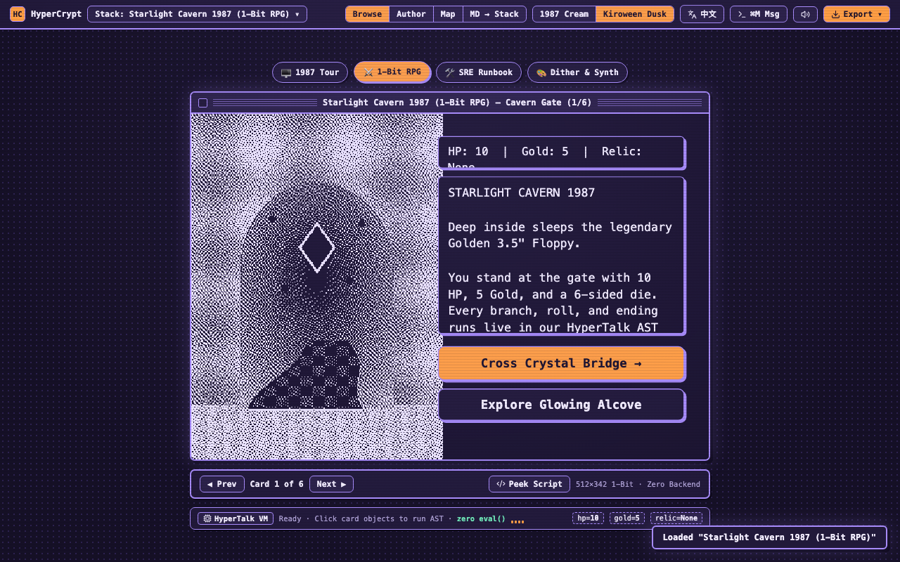
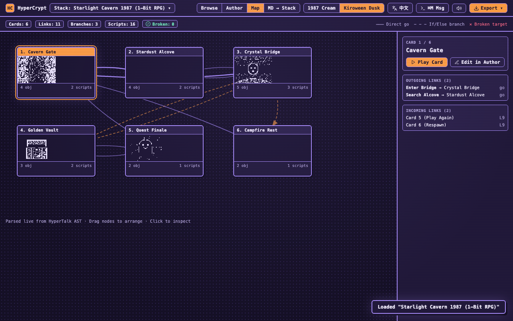
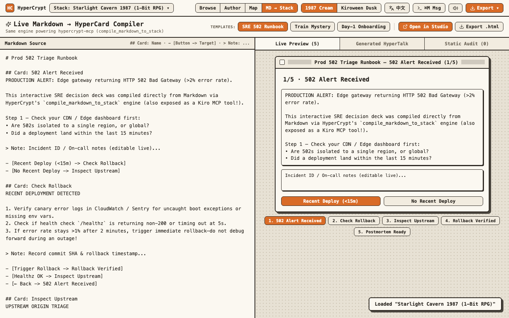
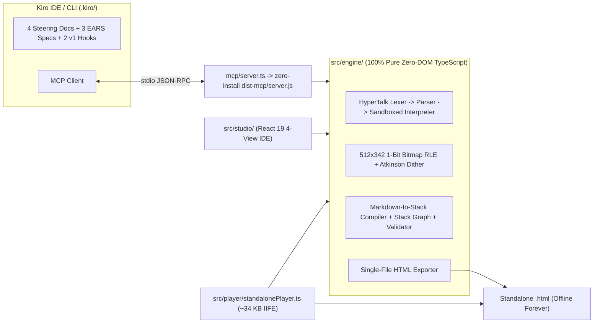

# HyperCrypt — 1987 Apple HyperCard & HyperTalk Resurrected

> Built from scratch for **Kiroween 2026** (AWS Kiro Hackathon · **Best Resurrection** + **Overall**)  
> **Live Demo**: https://hypercrypt.vercel.app *(Zero backend, zero login, instant launch)*  
> **License**: MIT

**HyperCrypt** resurrects **1987 Apple HyperCard & HyperTalk** for the modern web—bridging the gap between static Markdown and bloated cloud-dependent web apps. Build tactile **512×342 1-bit interactive card stacks** in your browser, write real plain-English **HyperTalk** scripts with a live step debugger, convert any photo with **Bill Atkinson 1-bit dithering**, export any stack into **one immortal offline `.html` file**, and compile Markdown runbooks into playable stacks directly from **Kiro IDE** via `hypercrypt-mcp`.

---

## Key Features

1. **Authentic Sandboxed HyperTalk Engine + AST Inspector (`src/engine/`)**
   - Hand-written Lexer, Recursive-Descent AST Parser, Syntax Highlighter, and Async Sandboxed Interpreter (zero `eval()`, zero `new Function()`).
   - Supports `on mouseUp / openCard / closeCard`, `global`, `put ... into/before/after`, math, `random(n)`, `if/else if/else`, `repeat times/with/while`, `visual effect`, `go to card`, `show/hide`, `set the label/text/checked`, `ask`/`answer` modals, `play`, `wait`, and custom handlers.
   - Enforces a strict **10,000 AST step budget** and **32-frame call depth limit** for infinite-loop immunity.
   - Includes a live **Syntax-Highlighted Script Editor**, **AST Tree Inspector**, **Step Mode Debugger**, **Live Engine Telemetry HUD**, and classic **`Cmd/Ctrl+M` Message Box**.

2. **Four-View Workstation (`Browse` · `Author` · `Map` · `MD → Stack`) & Bilingual UI (`EN / 中文`)**
   - **Browse Mode** (instant zero-friction landing + Live Engine HUD with live globals & audio pulse bars).
   - **Author Mode** (`Cmd/Ctrl+B` — drag/resize objects, 1-bit Pencil/Line/Rect/Bucket/Eraser, classic Mac patterns, Undo/Redo, Card Filmstrip, and **Bill Atkinson 1-Bit Error-Diffusion Dithering** photo importer).
   - **Interactive Stack Flow Map (`Map`)**: Parses every card's HyperTalk AST into a draggable 1-bit thumbnail node graph showing direct jumps, conditional branches, and real-time broken-link radar.
   - **Live Split-Screen Markdown → Stack Compiler (`MD → Stack`)**: Edit or paste Markdown on the left, see a playable HyperCard stack, syntax-highlighted generated HyperTalk, and static audit compile live on the right—then open in Studio or export offline `.html` in 1 click.
   - **Dual Skins**: 1-click toggle between **1987 Cream** and **Kiroween Dusk** (`Cmd/Ctrl+Shift+H`) + **EN / 简体中文** bilingual toggle.

3. **Four Built-In Flagship Stacks (EN + 中文, `src/presets/`)**
   - **The Attic Mac of 1987** *(6 cards · Default Landing)* — cozy interactive mystery & self-referential HyperTalk tour.
   - **Starlight Cavern 1987 (1-Bit RPG)** *(6 cards)* — playable multi-ending 1-bit mini-RPG with HP, Gold, Relics, and real `random(6)` dice duels.
   - **Prod 502 Triage Runbook** *(5 cards)* — practical SRE incident decision deck compiled directly from Markdown via `compileMarkdownToStack`.
   - **Atkinson Darkroom & Script Lab** *(4 cards)* — 1-bit dithering showcase, Web Audio soundboard, live HyperTalk calculator, and Message Box lab.

4. **Immortal Offline Single-File `.html` Export & URL Share**
   - Exports any stack into a single standalone `.html` file embedding the **exact same TypeScript HyperTalk engine** (`esbuild` IIFE bundle, ~33 KB)—works offline forever with zero external requests.
   - Share small stacks via `#stack=` URL hash or export/import `.hcstack.json`.

5. **Custom Kiro MCP Server (`mcp/server.ts` → `dist-mcp/server.js`)**
   Exposes 4 domain-specific tools to Kiro IDE/CLI via `.kiro/settings/mcp.json`:
   - `validate_hypertalk` — AST syntax validation with line/column diagnostics & handler signatures
   - `validate_stack` — whole-stack static analysis catching syntax errors & broken `go to card` targets
   - `run_hypertalk_script` — headless sandboxed execution returning resulting card, globals, fields, audio, dialogs & trace
   - `compile_markdown_to_stack` — compiles structured Markdown docs/runbooks into validated `.hcstack.json` decks

---

## Kiro Workflow (`.kiro/` Specs, Hooks & MCP)

The repository contains these **Kiro spec-driven workflow artifacts**. All four MCP tools and the engine save Hook were exercised in Kiro IDE on 2026-11-26; see [live verification and evidence](docs/KIRO_LIVE_CHECK.md). This validates the current workflow, without asserting that all earlier development took place in Kiro.
- **`.kiro/steering/`**: 4 steering docs (`product.md`, `tech.md`, `structure.md` with `inclusion: always`, plus `hypertalk-grammar.md` with `fileMatch: "src/engine/**"`).
- **`.kiro/specs/`**: 3 complete EARS specification suites (`hypertalk-engine`, `stack-studio`, `export-and-mcp`), each with `requirements.md`, `design.md`, and `tasks.md`.
- **`.kiro/hooks/`**: Kiro v1 event hooks (`engine-guard.json`, `stack-validator.json`) running unit tests and preset static validation on save.
- **`.kiro/settings/mcp.json`**: Registers the local `hypercrypt` stdio MCP server (`node dist-mcp/server.js`).

---

## Screenshots

| 1987 Cream · Browse Mode & Showcase Dock | Kiroween Dusk · 1-Bit RPG & Live Engine HUD |
| :---: | :---: |
|  |  |

| AST-Derived Stack Flow Map | Live Split-Screen `MD → Stack` Compiler |
| :---: | :---: |
|  |  |

---

## Architecture



---

## Quick Start & Testing

```bash
# Install dependencies
npm install

# Build standalone player bundle, web SPA, and MCP server
npm run build

# Start local dev server
npm run dev

# Validate all built-in stacks statically
npm run validate:presets

# Run Layer 1 (Unit + Live MCP) & Layer 2 (React Integration) tests
npm test

# Run Layer 3 (Playwright Chromium E2E + Offline Standalone .html verification)
npm run test:e2e
```
