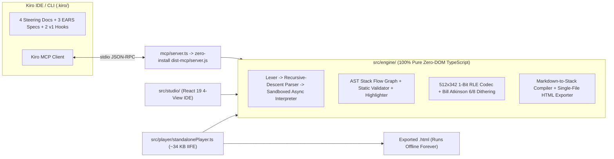

# Resurrecting 1987 Apple HyperCard & HyperTalk with Kiro Spec-Driven Development

> *Built from scratch for **Kiroween 2026** (AWS Kiro Hackathon · Best Resurrection)*  
> **Live App (Zero Login)**: https://hypercrypt.vercel.app  
> **Open-Source Repository (MIT + `/.kiro`)**: https://github.com/pan609/hypercrypt

---

## 1. The Lost Middle Ground of Personal Software

Four years before the first web page went live at CERN, Bill Atkinson shipped **HyperCard** on the 1987 Apple Macintosh. Its premise was radical in its simplicity: every document was a **Stack** of crisp 512×342 1-bit **Cards**. You could sketch artwork with pixel patterns, drop buttons and text fields onto a card, and attach plain-English **HyperTalk** scripts like:

```hypertalk
on mouseUp
  global floppyLoaded
  if floppyLoaded >= 1 then
    play "unlock"
    visual effect iris open
    go to card "Boot Floppy"
  else
    answer "Tap the smiling 1987 Mac first!" with "Got it"
  end if
end mouseUp
```

No servers, no package managers, no cloud lock-in—just tactile, self-contained personal software that engineers, writers, teachers, and kids could open, inspect, and remix in minutes.

Apple discontinued HyperCard in 2004, and twenty-two years later we still suffer from the gap it left behind:
- **Static Markdown & slides** are immortal and version-controlled, yet lifeless—they cannot branch on user choices, roll dice, track state, or run an interactive incident checklist.
- **Modern web apps & SaaS tools** are richly interactive, yet heavy, login-walled, dependent on third-party clouds, and vulnerable to link rot the moment a server shuts down.

For **Kiroween 2026**, I set out to resurrect HyperCard and HyperTalk—not as a hollow nostalgia skin, but as a modern **4-view creative IDE** that bridges 1987 hypermedia with 2026 engineering workflows:
1. **Play & Author** 512×342 1-bit stacks directly in the browser with warm **1987 Cream** and playful **Kiroween Dusk** dual skins (plus full EN / 简体中文 support).
2. **Inspect & Visualize** every script through a syntax-highlighted editor, a live **AST Tree Inspector**, a **Step Mode Debugger**, and a draggable **Stack Flow Map** with broken-link radar.
3. **Compile Modern Markdown** into playable HyperCard decks in real time—both in-browser (`MD → Stack`) and inside **Kiro IDE** via our custom `hypercrypt-mcp` server.
4. **Export Immortal Single-File `.html` Capsules** that bundle the exact TypeScript HyperTalk engine into one ~34 KB offline runtime that runs anywhere forever.

---

## 2. Architecture: One Pure Engine Powering Three Runtimes

Early in design, one trap stood out immediately: if the browser Studio, the exported offline `.html` file, and the Kiro MCP server each ran slightly different script evaluators, subtle behavioral drift would creep in everywhere.

Instead, we enforced a strict single-engine architecture directly inside `.kiro/steering/tech.md`:



### Why Zero-DOM Purity Matters
Nothing inside `src/engine/` imports React or touches `window` or `document`. Every side effect—navigating cards, updating fields, popping classic Mac `ask`/`answer` modals, synthesizing retro audio, or pausing for Step Mode debugging—flows through a single `RuntimeHost` interface.

That strict boundary gave us three massive wins for free:
- **Browser Studio** (`src/studio/store/useStudioStore.tsx`) implements `RuntimeHost` over React state + Web Audio + CSS transitions.
- **Standalone Offline Player** (`src/player/standalonePlayer.ts`) implements `RuntimeHost` over lightweight vanilla DOM + a singleton `AudioContext`, compiled by `esbuild` into a ~34 KB minified IIFE (`npm run build:player`) and embedded straight into every exported `.html` file.
- **Headless MCP Runner** (`src/engine/headlessHost.ts`) implements `RuntimeHost` in pure Node memory with instant `fastWait` and mock dialog queues—so Kiro IDE can execute and assert HyperTalk gameplay headlessly in milliseconds!

All three runtimes share identical `closeCard` and `openCard` lifecycle semantics, identical `global` state persistence, and identical sandbox safety limits.

---

## 3. Deep Technical Highlights Under the Hood

### Zero-`eval()` Sandboxed HyperTalk VM
Many browser scripting demos cheat by transpiling strings into `new Function()` or `eval()`, creating XSS risks and allowing `while(true)` to freeze the tab.

HyperCrypt implements a genuine, hand-written pipeline:
- **`lexer.ts`**: Case-insensitive tokenization with exact 1-based `line` and `column` offsets, `--` comments, line continuation, and string escapes.
- **`parser.ts`**: Recursive-descent AST parser with operator precedence climbing (`or` → `and` → `not` → comparisons/`is`/`contains` → `&`/`&&` → arithmetic → unary) plus careful disambiguation so `answer "Save?" with "Cancel" or "Save"` never collides with boolean `or`.
- **`interpreter.ts`**: Async AST walker supporting `global`, `put ... into/before/after`, math mutations, `random(n)`, `if/else if/else`, `repeat times/with/while`, `visual effect`, `go to card`, `show/hide`, `set the label/text/checked`, `ask`/`answer`, `play`, `wait`, custom handlers, and live step-by-step hooks.
- **Hard Resource Budgets**: Every event invocation caps at **10,000 AST steps** and **32 call-stack frames**, throwing a clean `SandboxLimitError` before an infinite loop can ever hang a browser tab or MCP process.

### True Bill Atkinson 1-Bit Error-Diffusion Dithering & Lossless RLE
Bill Atkinson didn't just create HyperCard—he also invented the iconic **Atkinson dithering algorithm** for the original Macintosh. Unlike Floyd–Steinberg dithering (which diffuses 100% of quantization error), Atkinson diffuses only **6/8 (75%)** across six neighbors:

```text
        [ * ]  1/8   1/8
   1/8   1/8   1/8
         1/8
```

Dropping 25% of the error intentionally preserves crisp paper highlights and airy midtones that look unmistakably like 1987 Macintosh printmaking. Because HyperCrypt stores every 512×342 card drawing as a lossless 1-bit Run-Length Encoded string (`rle1:...`, typically 1–6 KB of clean ASCII), switching between **1987 Cream** and **Kiroween Dusk** instantaneously re-colors every pixel illustration without re-running dithering or shipping heavy PNGs.

### Safe Single-File `.html` Immortality
When you click **Export → Export Single-File .html**, `htmlExporter.ts` embeds the stack JSON inside `<script id="hc-stack-data" type="application/json">` with `<`, `>`, `&`, and Unicode line separators escaped to prevent script-tag breakout XSS, then appends our ~34 KB `standalonePlayer.bundle.txt`. Double-clicking the resulting file works completely offline—even with zero internet access.

---

## 4. How Kiro Spec-Driven Development Kept Us Honest

Building a language interpreter, 1-bit pixel studio, AST flow graph, Markdown compiler, and MCP server in a tight hackathon sprint can easily spiral into fragile spaghetti. **Kiro** kept the entire lifecycle disciplined:

1. **Steering as Living Guardrails (`.kiro/steering/`)**:
   - `product.md`, `tech.md`, and `structure.md` (`inclusion: always`) locked down architectural invariants: zero `eval()`, zero DOM in `src/engine/`, lifecycle parity, and clean-clone `pre*` build hooks.
   - `hypertalk-grammar.md` (`inclusion: fileMatch` scoped to `src/engine/**`) ensured every syntax addition—like `random(n)` for our 6-card *Starlight Cavern 1987* mini-RPG—stayed documented and backward-compatible.
2. **Three EARS Specs (`.kiro/specs/`)**:
   - `hypertalk-engine`, `stack-studio`, and `export-and-mcp` each captured testable EARS requirements (`WHEN ... THE SYSTEM SHALL ...`), explicit designs, and wave-ordered task checklists before coding began.
3. **Kiro v1 Agent Hooks (`.kiro/hooks/`)**:
   - `engine-guard.json` triggers `npm run test:unit` automatically on `PostFileSave` for `src/engine/*.ts` and prompts grammar-doc synchronization on parser/interpreter edits.
   - `stack-validator.json` automatically runs `npm run validate:presets` across all **10 built-in EN + ZH stacks & templates** whenever a preset changes, catching broken `go to card` links immediately.
4. **Zero-Install Custom MCP Server (`.kiro/settings/mcp.json` + `mcp/server.ts`)**:
   - Instead of requiring `tsx` or slow cold starts, `npm run build:mcp` bundles `mcp/server.ts` and its SDK dependencies into a single **376 KB zero-install `dist-mcp/server.js`** committed to git.
   - Opening the repo in Kiro IDE immediately connects 4 domain-specific tools: `validate_hypertalk`, `validate_stack`, `run_hypertalk_script`, and `compile_markdown_to_stack`.
   - Even better: we dogfooded our own compiler to generate the built-in **Prod 502 Triage Runbook** directly from Markdown!

---

## 5. Three-Layer Verification (Including True Offline Proof)

To guarantee a judge-proof experience on clean clones and in production:
- **Clean-Clone Automation**: `predev`, `pretypecheck`, `pretest`, `pretest:unit`, `pretest:integration`, and `prepreview` automatically build `src/player/generated/standalonePlayer.bundle.txt` so `git clone && npm install && npm run dev` never fails.
- **Layer 1 & 2 (Vitest)**: Covers lexer/parser diagnostics, infinite-loop and recursion guards, `openCard`/`closeCard` lifecycle parity, Atkinson dithering determinism, multi-row Markdown compilation, live stdio JSON-RPC calls against `dist-mcp/server.js`, and React Testing Library user flows.
- **Layer 3 (Playwright Chromium E2E)**: Plays through puzzles, toggles **Kiroween Dusk**, verifies **Stack Flow Map** and **MD → Stack**, intercepts the downloaded single-file `.html`, opens it in a fresh page with **`page.route('**/*', route => route.abort())`** (100% network blocked), toggles the dark theme on the standalone document, and asserts zero console or page errors.

---

## 6. Try HyperCrypt Live

- **Live App (Zero Login)**: https://hypercrypt.vercel.app
- **Public GitHub Repo (MIT)**: https://github.com/pan609/hypercrypt

Use the top Showcase Dock to jump across **1987 Tour**, **1-Bit RPG**, **SRE Runbook**, and **Dither & Synth**; inspect the live **Map** and **AST** views; edit live Markdown in **MD → Stack**; and export your own offline-forever `.html` card stack. Happy Kiroween 2026!
